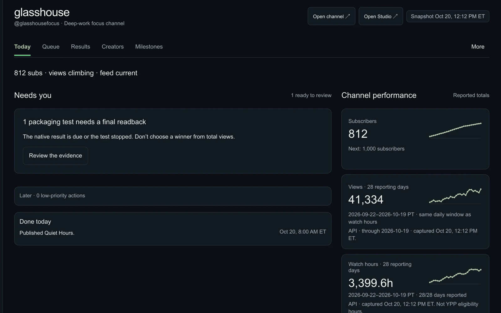
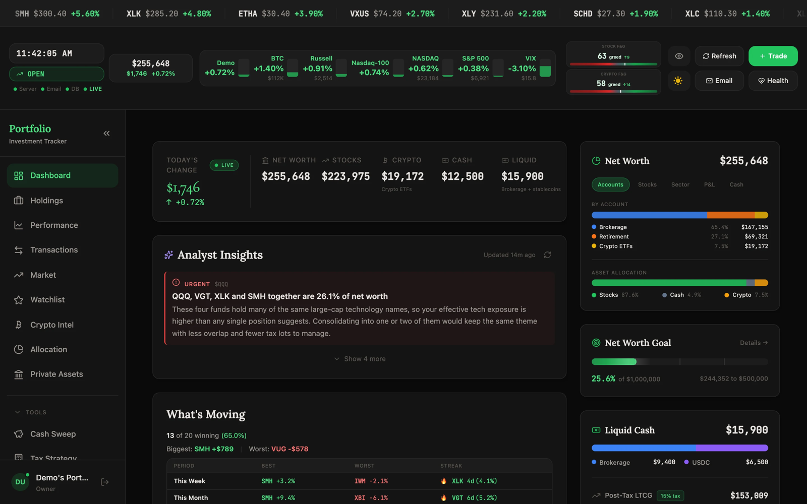
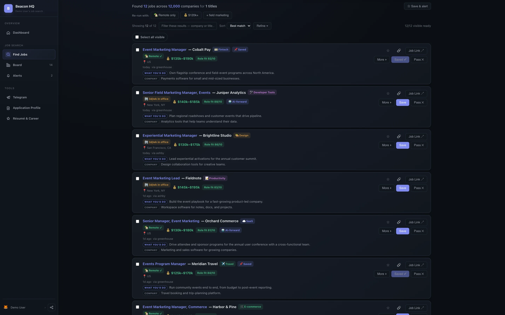
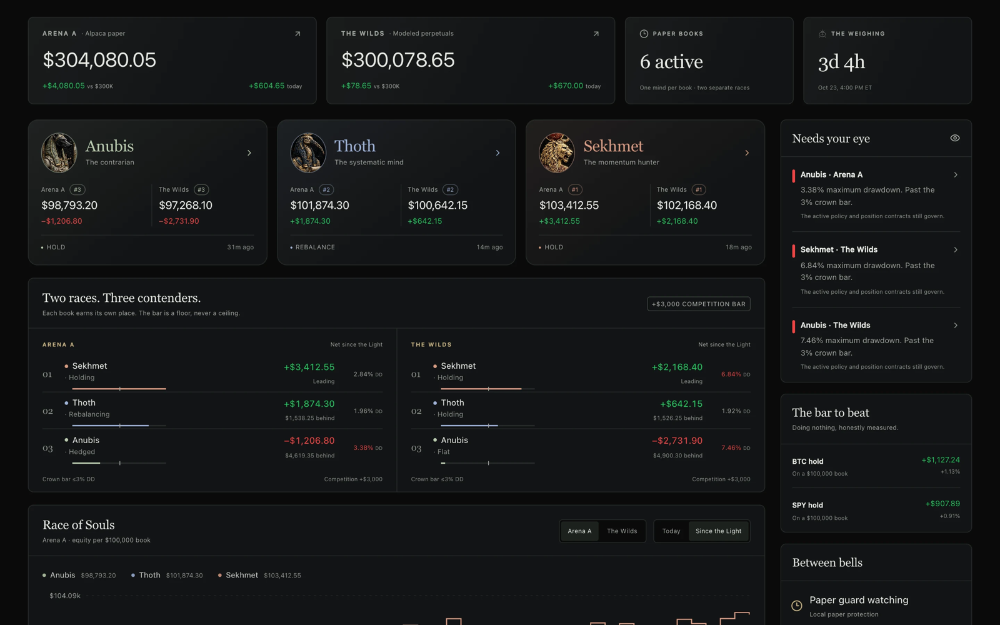

# Jonny Cangemi

**Strategic finance by day — Kraken (Onchain pod). Builder the rest of the time.**
Goldman Sachs IB → Lili → DriveWealth (Corp Dev & Strategy) → Kraken. I build the tools I wish existed, mostly with AI in the loop: products, dashboards, and automations that run every day.

**Full project cards → [jonnycangemi.com/projects](https://jonnycangemi.com/projects)**

---

## Featured builds

### glasshouse — YouTube automation system

A YouTube ambient-music channel that runs like a business: a production pipeline on a Mac Mini, a Telegram approval gate (nothing publishes without a human tap), and a custom owner cockpit for watch time, releases, and audience.
Daily 8 AM ET releases · 12h lives · titles in 15 languages · [Watch on YouTube](https://www.youtube.com/@glasshousefocus) · *Code private — Ensora Ventures*

### Portfolio Automation

Full-stack portfolio tracking and analytics: real-time streaming, multi-account support, tax optimization, and an evidence-backed daily brief that explains what moved and why.
*Demo-data screenshots only — code private*

### Beacon — job finder

Multi-source job search and application pipeline for a friends-and-family workspace: 12,000+ companies, US-remote filtering, Kanban tracking.
**Live:** [beaconjobtracker.jonnycangemi.com](https://beaconjobtracker.jonnycangemi.com) · *Code private*

### Tournament of Gods — simulated paper trading

Autonomous AI traders (SEKHMET · THOTH · ANUBIS) compete across 6 paper books and 2 arenas — every decision logged and explained. **Paper only: no real trades, ever.** Next: the winning strategy graduates to a supervised agentic paper bot.
*Code private*

### Also built
- **AI Usage Meter** — native macOS menu-bar widget for Claude + Codex capacity. Local-first, 7 themes. *(Swift)*
- **Miami Apt Tracker** — every Brickell and Downtown rental tracked like a comp set: 38 buildings, price history, refreshed 2× daily. Screenshots on the site.
- **jonnycangemi.com** — this profile's home site: Next.js 15, a custom pixel-scene engine, dark/light worlds.

---

## Consulting — Ensora Ventures
Ad hoc consulting: website builds, internal dashboards, and financial models for advisory clients. Details on request.

## Elsewhere
[Website](https://jonnycangemi.com) · [glasshouse on YouTube](https://www.youtube.com/@glasshousefocus) · [Beacon](https://beaconjobtracker.jonnycangemi.com) · Email: ensoraventures@gmail.com <!-- TODO Jonny: add LinkedIn URL -->
